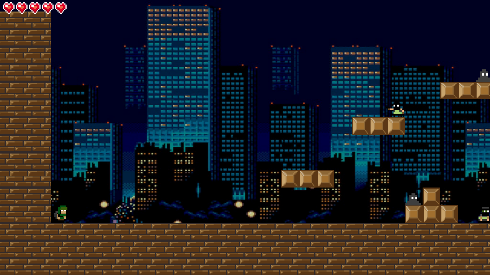

# Night City

A small 2D pixel-art platformer shooter. Run through the city at night, shoot the monsters and reach
the end of the level before you lose all five lives.

The Windows build is on [itch.io](https://floydnt.itch.io/night-city).



## Controls

| Action | Input |
| --- | --- |
| Move | A / D |
| Jump | Space |
| Shoot | Left mouse button |

## Getting started

1. Install **Unity 6000.3.2f1** (Unity 6.3 LTS) through Unity Hub.
2. Add this folder as a project in Unity Hub and open it.
3. Open `Assets/_Project/Scenes/Menu.unity` and press Play.

To build the game, use **File → Build Profiles → Windows → Build**. The four scenes are already in the
build list.

## Project layout

```
Assets/_Project/
  Animations/   animator controllers and clips
  Audio/Music/  one theme per scene
  Physics/      physics materials
  Prefabs/      character, monsters, projectiles, hazard
  Scenes/       Menu, Level, GameOver, FinishGame
  Scripts/      the NightCity assembly: Gameplay/ and UI/
  Sprites/      sprite sheets and screens
  Tiles/        level tiles and the tile palette
```

The level geometry is a Tilemap. Edit it in **Window → 2D → Tile Palette** with `LevelPalette`.

## How the code fits together

- `Character` reads input, moves through its `Rigidbody2D`, shoots and raises `LivesChanged`.
- `Monster` dies from a single hit; `PatrollingMonster` walks between obstacles and `ShootingMonster`
  fires at the character on a timer.
- A `ProjectileLauncher` pools its `Projectile`s; a projectile damages units of the other `Team`.
- `LivesBar` listens to the character; `MenuButtons` and `SceneLoader` switch scenes.

## Credits

Game by FloyD (Nikita Terlyukevich).

Music: 8-bit covers by 8 Bit Universe.

- Menu: "Every Breath You Take" (The Police)
- Level: "The Chain" (Fleetwood Mac)
- Game over: "The Number of the Beast" (Iron Maiden)
- Victory: "Sgt. Pepper's Lonely Hearts Club Band" (The Beatles)

## License

The project is released under the [MIT License](LICENSE), except for third-party content, which the
license does not cover and which belongs to its owners:

- the music tracks in `Assets/_Project/Audio/Music` (covers by 8 Bit Universe of the songs listed
  above);
- the city background, `Assets/_Project/Sprites/CityBackground.jpg`.
